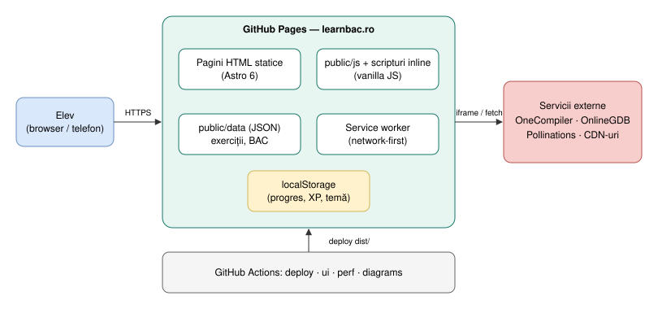

# Arhitectura InfoLiceu (astro-legacy)

Documentația descrie **cum funcționează site-ul acum** și se actualizează în fiecare PR care schimbă comportamentul. Fiecare document indică în antet ultimul PR care l-a modificat.

> `system-overview.drawio.svg` se editează direct în [draw.io](https://app.diagrams.net) sau cu extensia VS Code „Draw.io Integration”. Diagramele PlantUML (`diagrams/*.puml`) sunt randate în `.svg` de workflow-ul [diagrams.yml](../../../.github/workflows/diagrams.yml) la fiecare push pe un branch; workflow-ul pică dacă o diagramă are erori.

## Context și containere

| Context (C4 nivel 1) | Containere (C4 nivel 2) |
|---|---|
|  |  |

## Cuprins

| # | Document | Ce explică |
|---|---|---|
| 01 | [Build și deploy](01-build-deploy.md) | Drumul de la commit la learnbac.ro, workflow-uri |
| 02 | [Frontend](02-frontend.md) | Pagini Astro, layout-uri, scripturi, încărcarea unei pagini |
| 03 | [Stocare și progres](03-storage-progress.md) | Chei localStorage, XP, service worker |
| 04 | [Rulare C++](04-cpp-runner.md) | Editor, compilatoare externe, sandbox variante 2009 |
| 05 | [Debugger pas cu pas](05-debugger.md) | Simulatorul `debug-live` |
| 06 | [Voce](06-voice.md) | Audio/TTS (dezactivat acum) |
| 07 | [Admin, configurare, health](07-admin-config-health.md) | Comutatoare globale (planificat) |
| 08 | [Analiză AI](08-ai-analysis.md) | `analiza-bac` și furnizorul AI |
| 09 | [Date BAC](09-bac-data.md) | PDF → JSON → pagini |
| 10 | [Testare și performanță](10-testing-performance.md) | Playwright, Lighthouse CI, rapoarte |

## Reguli

- Orice PR care schimbă un flux actualizează documentul și diagrama lui.
- Diagramele noi: `.puml` în `diagrams/` (SVG-ul e generat de CI) sau `.drawio.svg` pentru diagrame desenate.
- Textul descrie starea reală; ce e planificat apare explicit ca „Planificat (PRx)”.
